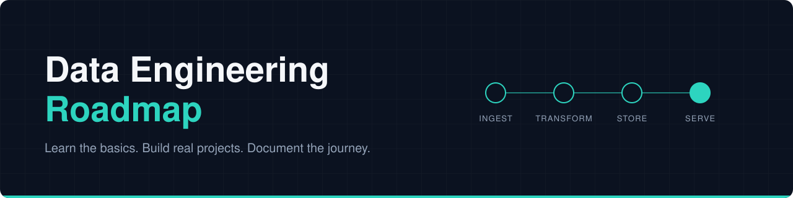

<p align="center">
  
</p>

<p align="center">
  <a href="https://instagram.com/thefirst_henry"></a>
  &nbsp;
  <a href="https://github.com/officialHW"></a>
</p>

A build-first roadmap for people who want to move into data engineering: learn the basics, build real projects, and document the journey in public.

> The goal is not to learn every data tool. The goal is to understand how data systems work, build them, break them, fix them, and explain the decisions behind them.

---

## Start here

New to data? You don't need to know anything yet. Pick the first step and begin.

| Step | What to do | Where | Status |
|:---:|---|---|:---:|
| **01** | Learn SQL with my beginner series and practice database | [`/sql`](sql/) |  |
| **02** | Learn Python basics | `/python` |  |
| **03** | Build Project 1: API to Data Warehouse | Own repository |  |

**[Open the SQL practice database](sql/README.md).** Copy one file, paste it into a free website, and you're querying data in two minutes.

---

## What is data engineering?

Data engineers build the **pipes** that move data from where it is created to where people can use it.

Think of plumbing for data. An app creates data, a pipeline carries it, cleans it and stores it, and analysts and dashboards use it at the other end.

---

## The journey at a glance

```
Python + SQL  >  Ingestion  >  ETL / ELT  >  Modelling  >  Warehouses
   >  Batch  >  Streaming  >  Data quality  >  Orchestration
   >  Cloud  >  CI/CD + Infrastructure as Code
```

| Stage | In plain English |
|---|---|
| **Python + SQL** | The two main languages for working with data |
| **Data ingestion** | Getting data in from apps, files and APIs |
| **ETL / ELT** | Cleaning and reshaping data on its way to storage |
| **Data modelling** | Organising data so it's easy to use |
| **Data warehouse** | A database built for analysis, not for running apps |
| **Batch processing** | Handling data in scheduled chunks, like once a night |
| **Streaming** | Handling data the moment it arrives |
| **Data quality** | Checking the data is correct and complete |
| **Orchestration** | Running pipeline steps in the right order, on a schedule |
| **Cloud** | Running things on rented servers instead of your laptop |
| **CI/CD + IaC** | Using code to automatically test, deploy and set up systems |

---

## Live now: SQL series

I'm teaching SQL from the ground up, using one shared practice database: **The First Henry Store**, a pretend online shop with 250 customers, 40 products and 2,500 orders.

 

**What you get in [`/sql`](sql/):**

- the full practice database as a single file
- a two-minute setup guide with no installs
- starter queries to try straight away
- a diagram showing how the tables connect

Follow the series on Instagram: [@thefirst_henry](https://instagram.com/thefirst_henry)

---

## The five projects

Each stage connects to a project, so you build evidence of what you can do. Every project gets its own repository, linked here when it's ready.

### Project 1: API to Data Warehouse
Pull data from the internet, clean it, and store it in a database.<br>
    

### Project 2: End-to-End Data Platform
Combine several data sources into one analytics platform.<br>
   

### Project 3: Real-Time Data Pipeline
Handle data that arrives continuously instead of in batches.<br>
 

### Project 4: Data Quality and Observability
Catch bad, missing or stale data before anyone relies on it.<br>
   

### Project 5: Cloud Data Infrastructure
Deploy and reproduce the whole system in the cloud.<br>
  

---

## How to use this roadmap

1. **Start with the foundations.** Python, SQL, Git and GitHub, the command line, databases, APIs, and file formats like CSV and JSON. You don't need mastery before your first project.
2. **Follow the project order.** Each project builds on the last.
3. **Build in small steps.** Start with something that works, then improve it with commits, so the history tells the story.
4. **Write down your decisions.** What problem you solved, why you chose each tool, what broke, and how you fixed it.
5. **Don't just copy tutorials.** Use them to learn, then build from the problem.

> **Learn, build, test, break, investigate, fix, document, improve.**

---

## A production-ready mindset

A project isn't finished just because it runs on your laptop. As projects grow, aim to show these habits.

<details>
<summary><b>See the checklist, explained in plain English</b></summary>

<br>

| Habit | What it means |
|---|---|
| Reproducible setup | Anyone can run it and get the same result |
| Configuration management | Settings live outside the code |
| Automated testing | Code checks itself |
| Data validation | The data is checked before it's trusted |
| Error handling and logging | Failures are caught and recorded |
| Incremental processing | Only new data is processed each time |
| **Idempotency** | Running it twice gives the same result, not duplicates |
| CI/CD | Tests and deployment run automatically |
| Secrets management | Passwords and keys are never stored in code |
| Monitoring and observability | You find out when something breaks |
| Infrastructure as Code | Servers are set up with code, not clicks |

Not every project needs every habit. Complexity should grow with the project.

</details>

---

## Repository structure

```
Data-Engineering-roadmap/
├── README.md
├── LICENSE
├── assets/          banner and social buttons for this README
└── sql/             SQL series
    ├── README.md
    ├── assets/      banner for the SQL series
    ├── data/        the practice database (one SQL file)
    └── episodes/    notes and queries for each part
```

More folders, such as `python/`, will appear as the roadmap grows. Each of the five projects will live in its own repository and be linked from here.

---

## Progress

- [x] SQL series practice database published
- [ ] SQL foundations (series in progress)
- [ ] Python foundations
- [ ] Git and GitHub
- [ ] Project 1: API to Data Warehouse
- [ ] Project 2: End-to-End Data Platform
- [ ] Project 3: Real-Time Data Pipeline
- [ ] Project 4: Data Quality and Observability
- [ ] Project 5: Cloud Data Infrastructure

---

## Share your feedback

This roadmap gets better when you tell me what works and what doesn't. You can:

- **Share a thought or ask a question** in [Discussions](https://github.com/officialHW/Data-Engineering-roadmap/discussions).
- **Suggest an improvement or report a mistake** by [opening an issue](https://github.com/officialHW/Data-Engineering-roadmap/issues/new/choose). An issue is just a note that other people can see and reply to.
- **Comment on the reels** on [Instagram](https://instagram.com/thefirst_henry) if you don't have a GitHub account.

GitHub needs a free account for the first two. No question is too basic.

---

## Follow the build

This roadmap is built in public, one commit at a time, so you can see the journey and not just the polished end result. Star and watch this repo to follow along.

<a href="https://instagram.com/thefirst_henry"></a>
&nbsp;
<a href="https://github.com/officialHW"></a>

---

## The end goal

Not five repositories. The ability to look at any data problem and work through it:

```
What data do we have?  >  Where does it come from?  >  How do we ingest it?
>  How do we store it?  >  How do we transform it?  >  How do we know it's correct?
>  How do we schedule it?  >  How do we monitor it?  >  How do we deploy and maintain it?
```

---

## License

Released under the [MIT License](LICENSE).
