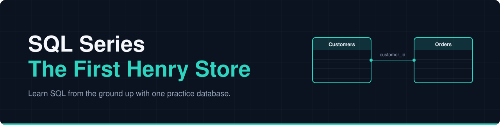
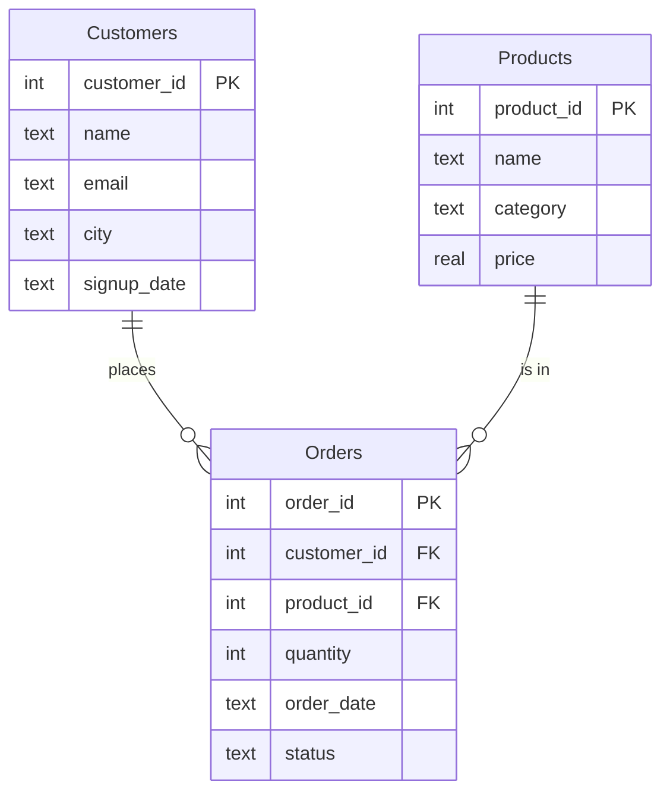

<p align="center">
  
</p>

# SQL Series: The First Henry Store

A practice database for my **SQL series**, where we learn data from the ground up.
<a href="https://instagram.com/thefirst_henry"></a>

No installs. No sign-up. Just copy, paste and start querying.

> All data is fake and made up for learning.

---

## What is this?

Think of it as a pretend online shop with **2,790 rows** of data to practise on.

| Table | Rows | What it holds |
|---|---|---|
| `Customers` | 250 | who our customers are and where they live |
| `Products` | 40 | what the shop sells, with category and price |
| `Orders` | 2,500 | who bought what, how many, when, and the order status |

The tables are linked together using IDs. This is exactly what makes it a **relational database** (also called an **RDBMS**):



*(How to read it: one customer can place many orders, and one product can appear in many orders.)*

---

## Quick start (2 minutes)

1. Open **[sqliteonline.com](https://sqliteonline.com)** and click the **SQLite** tab.
2. Open [`data/thefirst_henrystore.sql`](data/thefirst_henrystore.sql) in this folder, click the **Raw** button, then select all and copy.
3. Paste it into the editor and click **Run**.
4. Check it worked by running:

```sql
SELECT COUNT(*) FROM Orders;
```

You should see **2500**.

---

## Try your first queries

Run these one at a time. Select just the query you want before clicking **Run**, or delete the others.

**See the first 5 customers**
```sql
SELECT * FROM Customers LIMIT 5;
```

**The three most expensive electronics**
```sql
SELECT name, price
FROM Products
WHERE category = 'Electronics'
ORDER BY price DESC
LIMIT 3;
```

**How many orders are in each status?**
```sql
SELECT status, COUNT(*) AS total_orders
FROM Orders
GROUP BY status
ORDER BY total_orders DESC;
```

**Who bought what? (joining the tables)**
```sql
SELECT Customers.name, Products.name AS product, Orders.quantity
FROM Orders
JOIN Customers ON Orders.customer_id = Customers.customer_id
JOIN Products  ON Orders.product_id  = Products.product_id
LIMIT 5;
```

Don't worry if some of these look unfamiliar. We'll build up to every one of them in the series.

---

## What's in this folder

```
sql/
├── README.md        you are here
├── assets/          banner for this series
├── data/            the practice database (one SQL file)
└── episodes/        notes and queries for each part
```

---

## Troubleshooting

| Problem | Fix |
|---|---|
| My tables disappeared | The database lives in your browser's memory, so a refresh can wipe it. Paste and run the script again. |
| "Table already exists" error | Run the **whole** script, not just part of it. It clears old tables first. |
| Nothing happens when I click Run | Make sure the **SQLite** tab is selected, not another database. |
| I see an extra table called `demo` | That's the website's own sample. The script removes it when you run it. |

---

## Series episodes

| Part | Topic | Notes |
|:---:|---|---|
| 01 | Introduction: what SQL is for and why it matters | Coming soon |
| 02 | Who uses SQL: business analyst, data analyst, data engineer and data scientist | Coming soon |
| 04 | What SQL actually is, and the difference between a database and the tool you query it with | Coming soon |
| 05 | Types of databases: relational vs non-relational | [Open](episodes/part-05-types-of-databases/) |
| 06 | What we can actually do with the data inside them | Coming next |

Parts 01 to 05 cover the basics, so you understand what you are working with before we write full queries. Each episode gets its own folder in [`episodes/`](episodes/), with the notes and queries from that part.

More parts will be added here as the series grows.

---

## Messy data on purpose

Real data is never perfect, so this dataset isn't either:

- a few customers have **no email or city** (empty values, called `NULL`)
- some customers have **never placed an order**
- some customers order **far more** than others

We'll use these to learn how to spot and handle problems in later episodes.

---

## Using a different tool?

The script is standard SQLite, so it should also run in **DB Browser for SQLite** or the `sqlite3` command line.

[Back to the Data Engineering Roadmap](../README.md)
